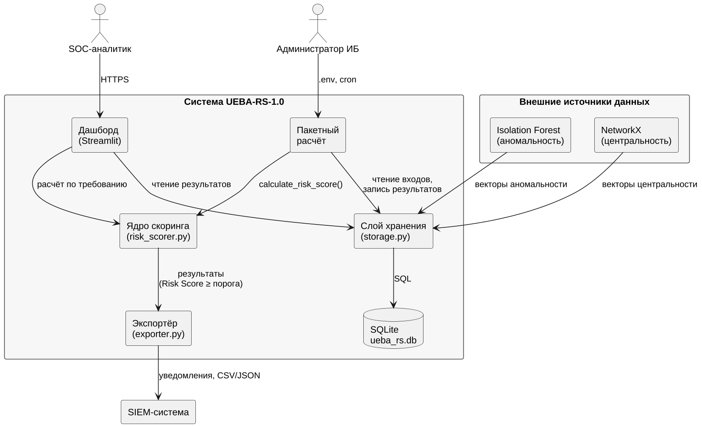
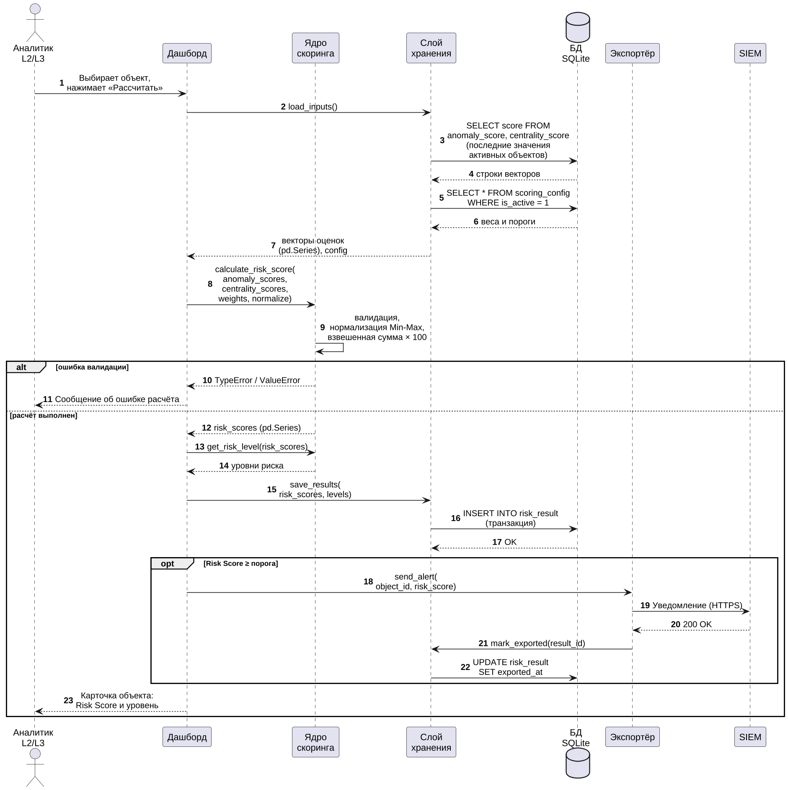

# Описание архитектуры системы

**Обозначение:** UEBA-RS.АР.01

**Основание:** раздел 3.3 учебного пособия; эскизный проект (лабораторная работа № 3), уровни Context и Container модели C4.

## 1. Общие сведения

Документ описывает архитектуру модуля UEBA-RS-1.0 для специалистов, которые сопровождают и развивают систему. Он уточняет решения эскизного проекта: диаграмма контекста (уровень Context модели C4) дополнена описанием контейнеров и потоков данных, а информационная база, определённая пятью сущностями в лабораторной работе № 3, получила физическую реализацию в виде базы данных SQLite.

## 2. Архитектурные принципы

- Ядро без состояния (stateless): функции calculate_risk_score() и get_risk_level() не хранят данные между вызовами, поэтому безопасны при многопоточном выполнении.
- Разделение ответственности (Separation of Concerns): расчёт, хранение, выгрузка и отображение вынесены в отдельные компоненты; ядро ничего не знает о базе данных и интерфейсе.
- Раннее обнаружение ошибок (fail-fast): входные данные проверяются до начала расчёта, при нарушении выбрасывается исключение, а не возвращается неверный результат.
- Векторизованные вычисления: расчёт выполняется над массивами pandas и NumPy, что обеспечивает обработку 10 000 объектов менее чем за 5 секунд.
- Простота развёртывания: система работает на одном узле, хранилищем служит файловая база данных SQLite без отдельного сервера.

## 3. Контейнерная архитектура

На рисунке показаны контейнеры системы, внешние источники данных и пользователи.

Таблица – Контейнеры системы

| Контейнер | Технология | Ответственность |
|---|---|---|
| Дашборд | Python, Streamlit | Отображение сводки, рейтинга и карточек; расчёт по требованию; выгрузка файлов |
| Пакетный расчёт | Python, cron | Ежечасный расчёт Risk Score для всех активных объектов, формирование ежедневных отчётов |
| Ядро скоринга | Python, pandas, NumPy | Валидация, нормализация Min-Max, расчёт и категоризация |
| Слой хранения | Python, sqlite3 | Чтение входных векторов и конфигурации, запись результатов, создание и миграция схемы |
| Экспортёр | Python | Выгрузка в CSV и JSON, передача уведомлений в SIEM |
| База данных | SQLite 3.40+ | Хранение объектов, входных оценок, конфигурации и результатов |

## 4. Технологический стек

Таблица – Технологии

| Назначение | Технология | Версия |
|---|---|---|
| Язык программирования | Python | 3.11 и выше |
| Обработка данных | pandas, NumPy | 2.0 и выше; 1.24 и выше |
| Источники оценок | scikit-learn (Isolation Forest), NetworkX | 1.3 и выше; 3.0 и выше |
| Веб-интерфейс | Streamlit | 1.28 и выше |
| Хранение данных | SQLite | 3.40 и выше |
| Тестирование | pytest | 7.0 и выше |
| Обратный прокси | nginx | из репозитория ОС |
| Операционная система | Ubuntu | 22.04 LTS |

## 5. Потоки данных

1. Модули Isolation Forest и NetworkX формируют оценки аномальности и центральности и передают их слою хранения; оценки сохраняются в таблицах anomaly_score и centrality_score.
2. Пакетный расчёт раз в час читает последние оценки активных объектов и активную конфигурацию скоринга.
3. Данные преобразуются в pandas.Series и передаются ядру; ядро проверяет их, нормализует и рассчитывает Risk Score.
4. Результаты и уровни риска записываются в таблицу risk_result в одной транзакции.
5. Экспортёр отправляет в SIEM уведомления по объектам, у которых Risk Score не ниже порога; успешная передача фиксируется в поле exported_at.
6. Дашборд читает результаты из базы данных и показывает их аналитикам.

## 6. Развёртывание

Система разворачивается на одном сервере или в контейнере Docker (образ python:3.11-slim). Дашборд запускается как служба systemd на локальном адресе 127.0.0.1:8501, внешний доступ предоставляет nginx по HTTPS. Пакетный расчёт, ежедневный отчёт и резервное копирование выполняются по расписанию cron. Подробные команды приведены в руководстве администратора.

## 7. Сквозные аспекты

- Безопасность: аутентификация на уровне обратного прокси, разграничение ролей, токен SIEM хранится только в файле .env с правами 600.
- Журналирование: стандартная библиотека logging; ошибки не выводятся функцией print(), а пробрасываются вызывающему коду.
- Производительность: расчёт для 10 000 объектов не более 5 секунд; индексы базы данных построены под запросы последних значений и рейтинга.
- Отказоустойчивость: недоступность SIEM не прерывает расчёт — результаты сохраняются и передаются повторно.

## 8. Взаимодействие компонентов с базой данных

Для иллюстрации выбран сценарий «Расчёт Risk Score по требованию» (аналитик L2/L3 запускает расчёт в дашборде). Диаграмма последовательности показывает обращения компонентов к базе данных; исходный текст на языке PlantUML хранится в файле diagrams/sequence-adhoc.puml.

Таблица – Описание шагов сценария

| Шаги | Описание |
|---|---|
| 1–2 | Аналитик выбирает объект и нажимает «Рассчитать»; дашборд запрашивает у слоя хранения входные данные |
| 3–6 | Слой хранения читает из базы данных последние оценки аномальности и центральности активных объектов и активную конфигурацию скоринга |
| 7–9 | Дашборд передаёт данные ядру; ядро проверяет их, нормализует и рассчитывает Risk Score |
| 10–11 | При ошибке валидации ядро выбрасывает исключение, аналитик получает сообщение, запись в базу данных не выполняется |
| 12–14 | При успешном расчёте ядро возвращает Risk Score, затем уровни риска |
| 15–17 | Слой хранения записывает результаты в таблицу risk_result в одной транзакции |
| 18–22 | Если Risk Score не ниже порога, экспортёр отправляет уведомление в SIEM и фиксирует время передачи в поле exported_at |
| 23 | Аналитик получает карточку объекта с Risk Score и уровнем риска |
