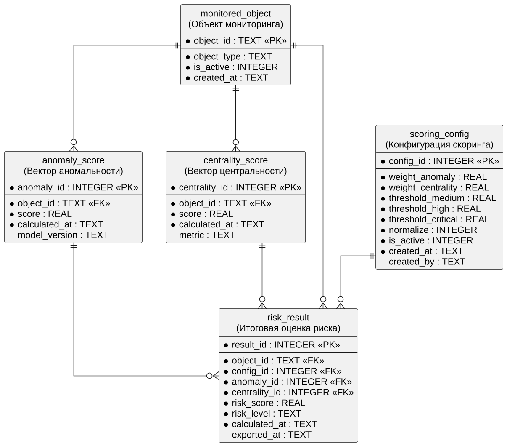

# Описание структуры базы данных

**Обозначение:** UEBA-RS.БД.01

**Основание:** раздел 3.3 учебного пособия; сущности данных из лабораторной работы № 3.

## 1. Общие сведения

Система использует реляционную базу данных SQLite (файл ueba_rs.db, путь задаётся параметром UEBA_DB_PATH). База данных хранит объекты мониторинга, входные оценки, конфигурацию скоринга и итоговые результаты. Каждой из пяти сущностей эскизного проекта соответствует одна таблица.

Таблица – Соответствие сущностей эскизного проекта таблицам базы данных

| Сущность (лабораторная работа № 3) | Таблица | Источник данных |
|---|---|---|
| Объект мониторинга | monitored_object | Система инвентаризации (CMDB), каталог пользователей |
| Вектор аномальности (Anomaly Score) | anomaly_score | Модуль Isolation Forest |
| Вектор центральности (Centrality Score) | centrality_score | Модуль NetworkX |
| Конфигурация скоринга (веса и пороги) | scoring_config | Администратор, файл .env |
| Итоговая оценка риска (Risk Score) | risk_result | Ядро скоринга |

## 2. Логическая модель



Связи между таблицами:

- один объект мониторинга имеет много оценок аномальности, много оценок центральности и много результатов расчёта (связи «один ко многим» по полю object_id);
- одна конфигурация скоринга используется во многих результатах (по полю config_id);
- каждый результат ссылается на конкретные оценки аномальности и центральности (поля anomaly_id и centrality_id), что позволяет воспроизвести расчёт.

## 3. Описание таблиц

### 3.1 Таблица monitored_object

Таблица содержит объекты мониторинга — учётные записи пользователей и хосты. Идентификатор объекта служит первичным ключом и используется как индекс массивов при расчёте.

Таблица – Поля таблицы monitored_object

| Поле | Тип | Ограничения | Описание |
|---|---|---|---|
| object_id | TEXT | PRIMARY KEY | Идентификатор: UserID учётной записи или IP-адрес/имя хоста |
| object_type | TEXT | NOT NULL, user или host | Тип объекта |
| is_active | INTEGER | NOT NULL, 0 или 1 | Признак участия в расчёте |
| created_at | TEXT | NOT NULL | Дата добавления (ISO 8601) |

### 3.2 Таблица anomaly_score

Таблица содержит оценки аномальности поведения, которые передаёт модуль Isolation Forest. Для каждого объекта хранится история оценок по времени расчёта.

Таблица – Поля таблицы anomaly_score

| Поле | Тип | Ограничения | Описание |
|---|---|---|---|
| anomaly_id | INTEGER | PRIMARY KEY | Уникальный идентификатор записи |
| object_id | TEXT | NOT NULL, FOREIGN KEY → monitored_object | Объект мониторинга |
| score | REAL | NOT NULL | Оценка аномальности (исходное значение) |
| calculated_at | TEXT | NOT NULL | Время расчёта оценки |
| model_version | TEXT | — | Версия модели, выдавшей оценку |

### 3.3 Таблица centrality_score

Таблица содержит оценки центральности объекта в графе сетевых связей, которые передаёт модуль NetworkX. Структура аналогична таблице anomaly_score.

Таблица – Поля таблицы centrality_score

| Поле | Тип | Ограничения | Описание |
|---|---|---|---|
| centrality_id | INTEGER | PRIMARY KEY | Уникальный идентификатор записи |
| object_id | TEXT | NOT NULL, FOREIGN KEY → monitored_object | Объект мониторинга |
| score | REAL | NOT NULL | Оценка центральности (исходное значение) |
| calculated_at | TEXT | NOT NULL | Время расчёта оценки |
| metric | TEXT | — | Использованная мера центральности |

### 3.4 Таблица scoring_config

Таблица хранит веса, пороги и флаг нормализации. Одновременно активна только одна запись; при изменении настроек создаётся новая запись, а прежняя помечается неактивной — так сохраняется история конфигураций.

Таблица – Поля таблицы scoring_config

| Поле | Тип | Ограничения | Описание |
|---|---|---|---|
| config_id | INTEGER | PRIMARY KEY | Идентификатор конфигурации |
| weight_anomaly | REAL | NOT NULL, от 0 до 1 | Вес аномальности (по умолчанию 0,6) |
| weight_centrality | REAL | NOT NULL, от 0 до 1 | Вес центральности (по умолчанию 0,4) |
| threshold_medium | REAL | NOT NULL | Нижняя граница уровня «Средний» (25) |
| threshold_high | REAL | NOT NULL | Нижняя граница уровня «Высокий» (50) |
| threshold_critical | REAL | NOT NULL | Нижняя граница уровня «Критический» (75) |
| normalize | INTEGER | NOT NULL, 0 или 1 | Признак нормализации |
| is_active | INTEGER | NOT NULL, 0 или 1 | Признак действующей конфигурации |
| created_at | TEXT | NOT NULL | Дата создания |
| created_by | TEXT | — | Кто внёс изменение |

Дополнительное ограничение: сумма weight_anomaly и weight_centrality равна 1,0 (с погрешностью 1e-6).

### 3.5 Таблица risk_result

Таблица содержит итоговые оценки риска. Поле «категория» (risk_level) заполняется только значениями из фиксированного справочника: Низкий, Средний, Высокий, Критический — по этому полю дашборд строит сводку по уровням риска.

Таблица – Поля таблицы risk_result

| Поле | Тип | Ограничения | Описание |
|---|---|---|---|
| result_id | INTEGER | PRIMARY KEY | Идентификатор результата |
| object_id | TEXT | NOT NULL, FOREIGN KEY → monitored_object | Объект мониторинга |
| config_id | INTEGER | NOT NULL, FOREIGN KEY → scoring_config | Использованная конфигурация |
| anomaly_id | INTEGER | NOT NULL, FOREIGN KEY → anomaly_score | Использованная оценка аномальности |
| centrality_id | INTEGER | NOT NULL, FOREIGN KEY → centrality_score | Использованная оценка центральности |
| risk_score | REAL | NOT NULL, от 0 до 100 | Итоговый Risk Score (2 знака после запятой) |
| risk_level | TEXT | NOT NULL, справочник из 4 значений | Категория риска |
| calculated_at | TEXT | NOT NULL | Время расчёта |
| exported_at | TEXT | — | Время передачи в SIEM (пусто, если не передавалось) |

## 4. Индексы

Таблица – Индексы

| Индекс | Таблица и поля | Назначение |
|---|---|---|
| ix_anomaly_object_time | anomaly_score (object_id, calculated_at) | Выбор последней оценки объекта |
| ix_centrality_object_time | centrality_score (object_id, calculated_at) | Выбор последней оценки объекта |
| ix_result_time_score | risk_result (calculated_at, risk_score) | Рейтинг объектов по последнему расчёту |
| ix_result_object | risk_result (object_id, calculated_at) | История Risk Score объекта в карточке |
| ix_result_exported | risk_result (exported_at) | Поиск результатов, не переданных в SIEM |

## 5. Пример определения таблиц

```sql
CREATE TABLE monitored_object (
    object_id   TEXT PRIMARY KEY,
    object_type TEXT NOT NULL CHECK (object_type IN ('user', 'host')),
    is_active   INTEGER NOT NULL DEFAULT 1 CHECK (is_active IN (0, 1)),
    created_at  TEXT NOT NULL
);

CREATE TABLE risk_result (
    result_id     INTEGER PRIMARY KEY AUTOINCREMENT,
    object_id     TEXT NOT NULL REFERENCES monitored_object(object_id),
    config_id     INTEGER NOT NULL REFERENCES scoring_config(config_id),
    anomaly_id    INTEGER NOT NULL REFERENCES anomaly_score(anomaly_id),
    centrality_id INTEGER NOT NULL REFERENCES centrality_score(centrality_id),
    risk_score    REAL NOT NULL CHECK (risk_score BETWEEN 0 AND 100),
    risk_level    TEXT NOT NULL
        CHECK (risk_level IN ('Низкий', 'Средний', 'Высокий', 'Критический')),
    calculated_at TEXT NOT NULL,
    exported_at   TEXT
);
```

## 6. Типовые запросы

Рейтинг десяти наиболее рискованных объектов по последнему расчёту:

```sql
SELECT object_id, risk_score, risk_level
FROM risk_result
WHERE calculated_at = (SELECT MAX(calculated_at) FROM risk_result)
ORDER BY risk_score DESC
LIMIT 10;
```

Результаты, не переданные в SIEM:

```sql
SELECT result_id, object_id, risk_score
FROM risk_result
WHERE risk_score >= 75 AND exported_at IS NULL;
```

## 7. Жизненный цикл данных

Таблица – Сроки хранения

| Данные | Срок хранения | Действие по истечении срока |
|---|---|---|
| Оценки аномальности и центральности | 90 дней | Удаление заданием обслуживания |
| Результаты расчёта | 180 дней | Удаление или выгрузка в архив SIEM |
| Конфигурации скоринга | Без ограничения | Хранятся для воспроизводимости расчётов |
| Объекты мониторинга | Пока присутствуют в CMDB | Признак is_active = 0 вместо удаления |
